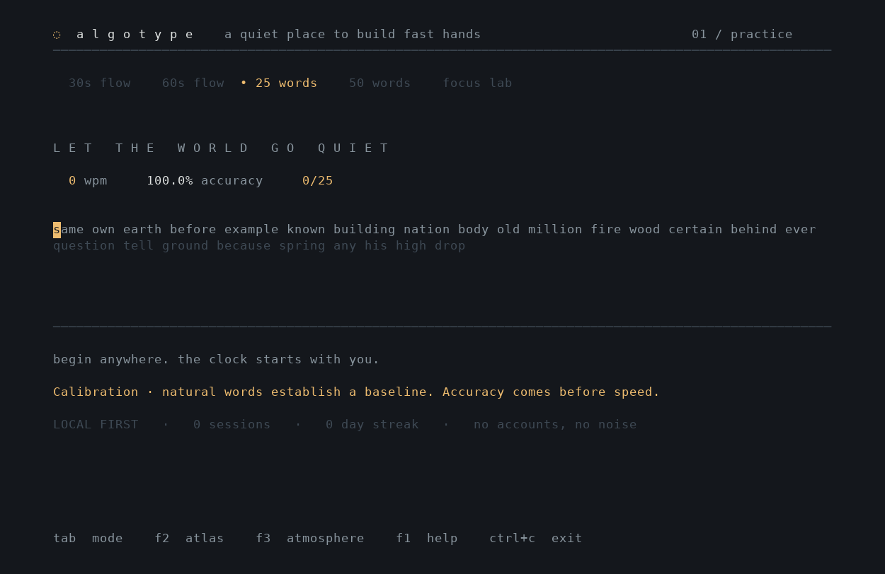
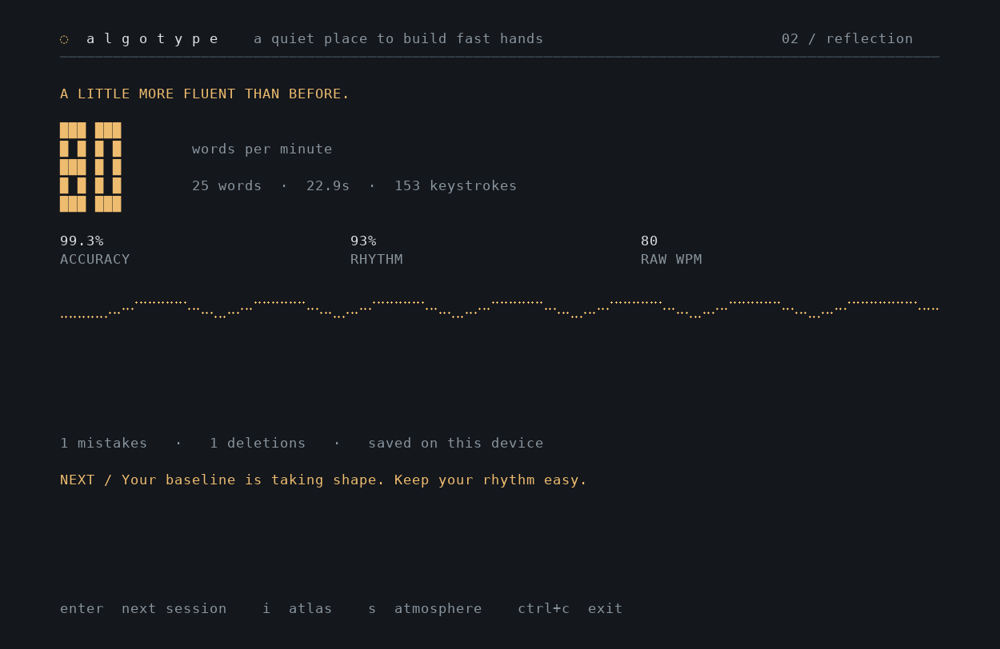

# Algotype

**A quiet place to build fast hands.**

Offline typing practice in Rust and Ratatui. A restrained, borderless interface; a learner that remembers difficult transitions; a local history that belongs to you.



## Install on Unix

Install once, then launch from any directory with **`algotype`**. These commands are for a POSIX shell such as Bash or Zsh on Linux or macOS.

You need `curl`, Git, and a C compiler/linker. On Debian/Ubuntu:

```sh
sudo apt-get update
sudo apt-get install -y curl git build-essential
```

On macOS, install Apple's command-line tools if they are missing:

```sh
xcode-select --install
```

Install the pinned Rust toolchain (skip the installer if you already use rustup):

```sh
curl --proto '=https' --tlsv1.2 -sSf https://sh.rustup.rs | sh -s -- -y --profile minimal --default-toolchain 1.90.0
. "$HOME/.cargo/env"
rustup toolchain install 1.90.0 --profile minimal
```

Install directly from this GitHub repository, without cloning it yourself:

```sh
cargo +1.90.0 install --git https://github.com/violatedheart/algotype.git --branch main --locked algotype
algotype
```

Cargo places the executable in `${CARGO_HOME:-$HOME/.cargo}/bin`. Rustup configures your shell's PATH; if a new terminal cannot find `algotype`, add that directory to your shell's startup configuration. For the default Cargo location, add this line to `~/.bashrc` (Bash) or `~/.zshrc` (Zsh), then open a new terminal:

```sh
export PATH="$HOME/.cargo/bin:$PATH"
```

If your shell exports `NO_COLOR`, run `NO_COLOR= algotype` to see the color palettes. `algotype --help` lists command-line options; `algotype --summary` prints saved progress without opening the TUI.

To update from GitHub, rerun the install command with `--force`. To uninstall, use `cargo uninstall algotype`; this leaves your local progress intact.

## Build from a checkout

```sh
git clone https://github.com/violatedheart/algotype.git
cd algotype
cargo run --release --locked
```

To install from that checkout instead:

```sh
cargo install --path . --locked
algotype
```

The repository pins Rust **1.90.0**, including rustfmt and Clippy. No database, server, API key, or runtime internet connection is required. The first build downloads crates; later builds can use `--offline`. The Git installation above builds from source; no prebuilt binary or crates.io publication is required.

Use a UTF-8 terminal with at least **44 columns × 18 rows**; 100 × 32 or larger gives the interface room to breathe. Truecolor and a font with box-drawing/Braille glyphs give the best result. `NO_COLOR=1` preserves cursor inversion and error underlines without color. Terminal resizing, bracketed paste rejection, and reduced motion are supported. Verified on Linux; macOS and Windows have not been validated.

## Find your flow

- **30 / 60 second flow:** the clock begins with the first printable character. Waiting before typing costs nothing.
- **25 / 50 words:** finish a fixed passage at your own pace.
- **Focus lab:** 30 words with a larger budget for your current training targets.

Every mode uses the same learner. Standard practice allocates 45% of selections to targeted words; Focus allocates 70%. The rest remains varied, natural English. These are sampling budgets, not guaranteed final proportions.

| Key | Action |
| --- | --- |
| Type | Start and continue a session |
| Backspace | Delete a character |
| Ctrl+W / Ctrl+Backspace | Delete the current word |
| Esc / Ctrl+R | Discard and restart an unfinished session |
| Tab, before typing | Cycle practice modes |
| F2, before typing | Open your atlas: history, patterns, key mastery |
| F3, before typing | Choose Afterglow, Botanical, or Paper; toggle reduced motion |
| F1, outside a running session | Read field notes |
| Enter, after a result | Start the next exercise |
| I / S, after a result | Open atlas / settings |
| ↑ / ↓, in atlas | Inspect older / newer recorded sessions |
| Ctrl+S | Retry saving current progress |
| Ctrl+C / Ctrl+Q | Flush pending writes and exit |

Errors occupy the expected character position and remain visible in coral with an underline. Incorrect spaces appear as `·`. Backspace lets you correct the passage; it never erases the mistake from your accuracy history. There is no cursor jumping or paste-to-score shortcut. Leaving a session unfinished does not train the learner or add a result. Completed sessions are saved automatically.



## What the numbers mean

- **WPM:** currently correct character positions ÷ 5 ÷ elapsed minutes. Spaces count. A one-second minimum denominator prevents explosive first-keystroke readings. The final duration freezes at completion or at the precise timed deadline.
- **Raw WPM:** all printable attempts, including incorrect characters and retyping, ÷ 5 ÷ elapsed minutes. Backspaces are reported separately as deletions.
- **Accuracy:** correct attempts ÷ all attempts. A corrected mistake still lowers accuracy.
- **Rhythm:** `100 × max(0, 1 − standard_deviation / mean)` of correct keystrokes per second, including idle seconds. The last fractional second is normalized. Very short sessions are inherently noisy; this is a practice signal, not a clinical measure of consistency.
- **Result graph:** correct-keystroke rate in each second. It can differ from net WPM when text is corrected. **Atlas graph:** final WPM for up to 30 recent sessions. Session results mix modes; compare like modes when evaluating progress.

## How practice adapts

The model is deliberately inspectable. See [the learning design](docs/learning.md) for formulas, assumptions, and limitations.

1. Observe expected characters and two-/three-character contexts. Sequence evidence is collected only when preceding typed characters match the passage. Incorrect prefixes cannot blame unrelated transitions.
2. Combine a conservative accuracy prior, a recent accuracy EWMA, transition timing relative to your median character timing, and estimated retention. Ignore patterns with fewer than eight observations.
3. Rank training priorities, then choose up to three non-overlapping targets that exist in the offline vocabulary. The practice explanation identifies **precision**, **hesitation**, or **review** as the reason for a target.
4. Mix targeted and exploratory words. Avoid repeating a word within the previous eight selections when candidates allow it. Longer vocabulary unlocks only after sustained speed **and** accuracy.
5. Extend retention stability after successful recall separated by at least twelve hours; shorten it after poor recall. Repetition inside one session cannot manufacture long-term mastery.

This is an algorithmic practice model, not an AI service. It has no online training, telemetry, or demonstrated guarantee of learning gains. Its behavior is tested; proving long-term improvement requires longitudinal user studies.

## Local data

The application uses the operating system's local application-data directory (on typical Linux systems, `~/.local/share/algotype`). Print the exact location and saved progress without opening the TUI:

```sh
algotype --summary
algotype --data-dir /path/to/separate/profile
```

`ALGOTYPE_DATA_DIR` also selects a directory; `--data-dir` takes precedence. Each directory is a separate profile. The schema-versioned `profile.json` retains the most recent **1,000 sessions**, lifetime session count, aggregate pattern evidence, and preferences. Lifetime bests, including bests per mode, survive history compaction. Streaks use UTC calendar days.

A dedicated worker performs saves outside the input path. Writes are flushed before atomic replacement; the preceding committed state is retained in `profile.backup.json`. On Unix, the directory is private and the directory entry is synced. An advisory lock rejects simultaneous instances using the same profile. Normal exit waits for queued writes. Hard termination can lose an in-flight write; the previous committed profile remains usable.

Corrupt profiles, invalid statistics, and newer schema versions produce an actionable error and are **never silently reset**. To recover, close all instances, preserve the damaged file, and copy `profile.backup.json` to `profile.json`. To start separately without touching existing data, use a new `--data-dir`. Save failures remain visible; use Ctrl+S to retry. No data is uploaded.

## Develop and verify

```sh
cargo fmt --check
cargo clippy --locked --all-targets -- -D warnings
cargo test --locked
cargo build --release --locked
```

The Rust tests cover correction-aware metrics, deadline behavior, context attribution, evidence thresholds, targeted exercise composition, spaced retention, transactional persistence, concurrent instance rejection, complete learn/save/reopen workflows, help navigation, and rendering across themes and terminal sizes.

An optional **real terminal integration test** checks typing, a corrected mistake, bracketed paste, results, persistent learning, settings, resize, reopening, and raw-mode/alternate-screen restoration:

```sh
python3 -m venv .venv
. .venv/bin/activate
pip install -r tests/requirements.txt
cargo build --locked
python tests/terminal_smoke.py
# Optional additional 30-second wall-clock check:
python tests/timed_smoke.py
```

This Linux/Unix PTY test writes only to a temporary profile. Captures go to `target/terminal-captures`; PNG captures are optional when Pillow is available. README images are captures of actual automated terminal sessions, not hand-drawn mockups. Their typing rates reflect automation.

The code separates `engine` (deterministic time/input analysis), `adaptive` (planning and learning), `model` (persisted schema), `store` (locking/atomic writes/worker), `app` (navigation and lifecycle), and `ui` (rendering). Input is drained in bounded batches. Active sessions render at up to 30 Hz; idle cursor motion uses 4 Hz; reduced-motion static screens render on changes. Animations use elapsed time rather than frame counts.

MIT licensed.
